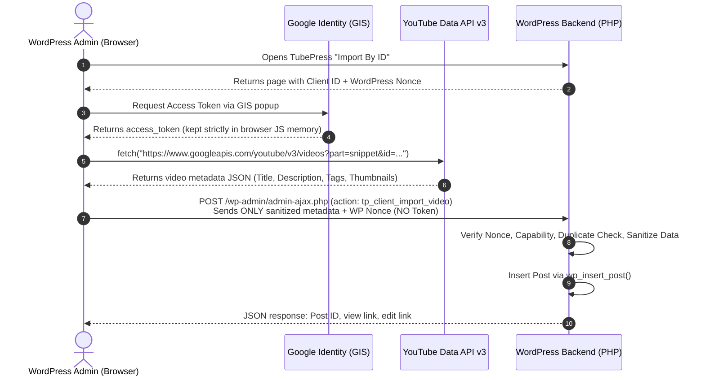

# TubePress.Net Simplified

[](https://wordpress.org/)
[](https://php.net/)
[](gpl.txt)
[](change%20log.txt)

**TubePress.Net Simplified** is a streamlined, security-hardened WordPress plugin that imports YouTube videos directly into your WordPress posts or pages using the **YouTube Data API (v3)**.

Designed with a modern **Zero-Backend-Token architecture**, all Google OAuth 2.0 authentication and API requests execute client-side directly within your browser. **No Google API access tokens, client secrets, or credentials ever touch or reside on your WordPress server.**

---

## Table of Contents

- [Key Features](#key-features)
- [Architecture Overview](#architecture-overview)
- [User Guide](#user-guide)
  - [Installation](#installation)
  - [Google Cloud Console Setup](#google-cloud-console-setup)
  - [Importing Videos](#importing-videos)
  - [Configuring Player & Templates](#configuring-player--templates)
  - [Responsive Video Styling](#responsive-video-styling)
- [Developer Guide](#developer-guide)
  - [Security Architecture](#security-architecture)
  - [Codebase Structure](#codebase-structure)
  - [Local Testing & Validation](#local-testing--validation)
- [Changelog](#changelog)
- [License](#license)

---

## Key Features

* **Zero-Backend-Token Security**: OAuth 2.0 bearer tokens are held exclusively in browser memory during your active session. Your WordPress database, cookies, and server logs never store Google tokens.
* **100% Self-Contained**: No server-side Composer, `vendor/autoload.php`, or heavy Google PHP SDK required. Completely immune to missing PHP dependency crashes.
* **Fast & Interactive AJAX Importer**: Paste a YouTube video ID or full URL (`https://youtu.be/...` or `https://www.youtube.com/watch?v=...`) to import with live status feedback, thumbnail previews, and instant view/edit post links.
* **Customizable Post & Excerpt Templates**: Tailor exactly how imported posts are formatted using intuitive template tags (`%tp_player%`, `%tp_title%`, `%tp_thumbnail%`, `%tp_thumbnail_best%`, `%tp_description%`, `%tp_url%`, `%tp_id%`).
* **Custom Field & Taxonomy Integration**: Automatically assigns YouTube tags to WordPress tags, maps comma-separated categories, and populates WordPress post meta custom fields.
* **Duplicate Prevention**: Built-in duplicate detection checks existing post content, excerpts, and post meta before importing to avoid duplicate entries.
* **Security Hardened**: Full CSRF protection via WordPress nonces, strict capability checks (`manage_options`), SQL injection defense using `$wpdb->prepare()`, and contextual output escaping (`esc_html`, `esc_attr`, `esc_url`, `esc_textarea`).

---

## Architecture Overview

Traditional video importer plugins require storing a Client Secret and Access/Refresh tokens in the WordPress MySQL database, creating a permanent risk of credential exposure if the server or database is ever compromised.

**TubePress.Net Simplified** eliminates this risk by utilizing **Google Identity Services (GIS)** and client-side CORS requests:



---

## User Guide

### Installation

1. Download or clone this repository into your WordPress plugins directory:
   ```bash
   cd /path/to/wordpress/wp-content/plugins/
   git clone https://github.com/geoff604/tubepressnet-simplified.git tubepressnet-simplified
   ```
2. Log in to your WordPress Admin Dashboard.
3. Go to **Plugins > Installed Plugins** and activate **TubePress.Net Simplified**.

---

### Google Cloud Console Setup

To import videos, you need a free **Google OAuth 2.0 Client ID**. You do **not** need a client secret or paid account.

1. Go to the [Google Cloud Console Credentials Page](https://console.cloud.google.com/apis/credentials).
2. Create a new project (or select an existing project).
3. Navigate to **APIs & Services > Library**, search for **YouTube Data API v3**, and click **Enable**.
4. Go to **APIs & Services > OAuth consent screen**:
   * Choose User Type: **External**.
   * Fill in your App Name (e.g., `My WordPress Video Importer`) and your support/developer email.
   * Save and continue (scopes are requested dynamically in the browser).
5. Go to **APIs & Services > Credentials**:
   * Click **+ CREATE CREDENTIALS** > **OAuth client ID**.
   * Set Application Type to **Web application**.
   * Under **Authorized JavaScript origins**, enter your exact WordPress site URL (e.g., `https://example.com` or `http://localhost:8080`).
   * Leave *Authorized redirect URIs* empty (authorization uses popup tokens, so no redirect URI is needed).
6. Copy your generated **Client ID** (format: `xxxxxxxxxxxx-xxxxxxxxxxxxxxxx.apps.googleusercontent.com`).
7. In WordPress, go to **TubePress > Setup**, paste the Client ID into the **Google OAuth Client ID** field, and click **Save Options**.

---

### Importing Videos

1. Navigate to **TubePress > Import By ID** in your WordPress dashboard.
2. In the **Video ID or URL** field, enter either:
   * The 11-character video ID: `ImtuJ-kzsAc`
   * Or a full YouTube URL: `https://www.youtube.com/watch?v=ImtuJ-kzsAc` or `https://youtu.be/ImtuJ-kzsAc`
3. *(Optional)* Enter category names (comma-separated) in the **Category** field.
4. Click **Import This Video**:
   * If not already authorized in this browser session, a Google login popup will request read-only access to YouTube.
   * TubePress will fetch video details from YouTube and create the post in WordPress via AJAX.
   * Once completed, an instant preview of the thumbnail, title, and buttons to **View Post** or **Edit Post** will appear.

---

### Configuring Player & Templates

Under **TubePress > Setup**, you can customize default settings:

* **Post Status**: Choose between `Published`, `Draft`, `Pending`, or `Private`.
* **Post Type**: Choose between `post` or `page`.
* **Remove Duplication**: When checked, prevents importing videos that already exist in your posts or custom fields.
* **Custom Fields**: Automatically populate custom fields (`tp_player`, `tp_thumbnail`, `tp_thumbnail_best`, `tp_title`, `tp_description`, `tp_duration`, `tp_author`, `tp_tags`, `tp_id`, `tp_url`) for advanced theme templating.
* **Content & Excerpt Templates**: Use any combination of HTML and the following tags:
  * `%tp_player%` - The responsive embedded video player
  * `%tp_title%` - The video title
  * `%tp_thumbnail%` - High-resolution thumbnail image URL (high quality)
  * `%tp_thumbnail_best%` - Highest available resolution thumbnail URL
  * `%tp_description%` - Full video description
  * `%tp_url%` - Direct YouTube video URL
  * `%tp_id%` - 11-character YouTube video ID

---

### Responsive Video Styling

TubePress wraps embedded players in `<div class="video-container-outer"><div class="video-container"><iframe class="video-iframe" ...>`. 

To enable 16:9 responsive auto-resizing across all devices, add the following CSS to your WordPress theme's stylesheet (**Appearance > Customize > Additional CSS**):

```css
.video-container {
  position: relative;
  overflow: hidden;
  width: 100%;
  padding-top: 56.25%; /* 16:9 Aspect Ratio (9 / 16 = 0.5625) */
}

.video-iframe {
  position: absolute;
  top: 0;
  left: 0;
  bottom: 0;
  right: 0;
  width: 100%;
  height: 100%;
}
```

---

## Developer Guide

### Security Architecture

* **Direct Execution Barrier**: [tubepress.php](tubepress.php) enforces `if (!defined('ABSPATH')) exit;` at the very beginning of the script to prevent path disclosure and direct script execution.
* **CSRF & Nonce Protection**: Settings forms and AJAX requests validate nonces via `check_admin_referer()` and `check_ajax_referer()`.
* **Authorization Checks**: All configuration management and video ingestion endpoints require `current_user_can('manage_options')`. Legacy numeric user levels have been retired.
* **SQL Injection Prevention**: All database queries (`tp_duplicate()`, `tp_insert_link()`) utilize `$wpdb->prepare()` with `$wpdb->esc_like()` wildcard escaping.
* **Strict Sanitization & Escaping**:
  * Inputs: `sanitize_text_field()`, `absint()`, `wp_kses_post()`, and regex matching for YouTube video IDs (`/^[a-zA-Z0-9_-]{11}$/`).
  * Outputs: `esc_html()`, `esc_attr()`, `esc_url()`, and `esc_textarea()`.

---

### Codebase Structure

```
tubepressnet-simplified/
├── tubepress.php     # Main plugin file: admin screens, AJAX endpoints, post generator
├── images/           # Color and border preview swatches & rating star assets
├── ReadMe.txt        # WordPress.org plugin directory specification file
├── change log.txt    # Changelog history
├── gpl.txt           # GNU General Public License v2
└── README.md         # GitHub repository documentation (this file)
```

---

### Local Testing & Validation

The codebase is tested and verified for compatibility with **WordPress 5.0 through 7.1** and **PHP 7.4 through 8.5+**.

#### PHP Syntax Linting
Validate that the plugin code contains no syntax errors:
```bash
php -l tubepress.php
```

#### Unit Testing
You can run automated mocks to verify that the security barriers, database queries, and client-side ingestion logic function as expected:
```bash
php path/to/test_tubepress.php
```

---

## Changelog

See [change log.txt](change%20log.txt) and [ReadMe.txt](ReadMe.txt) for full version history.

* **4.4.0**: Added `%tp_thumbnail_best%` template tag and `tp_thumbnail_best` custom field. Selects the highest available YouTube thumbnail resolution (maxres > standard > high > medium > default) via client-side cascade and passes it through the AJAX import pipeline.
* **4.3.0**: Implemented Zero-Backend-Token architecture. YouTube metadata is fetched directly in browser via client-side OAuth 2.0 (Google Identity Services). Removed server Composer/Google SDK dependencies. Added in-app setup guide with dynamic origin detection and interactive AJAX importer. Removed obsolete `JSON.php` and `locale/` files.
* **4.2.1**: Security hardening release: CSRF nonces, `$wpdb->prepare()` SQL injection defense, output escaping, and authorization capability checks.
* **4.2.0**: Initial migration toward client-side Google authentication.
* **4.0.0**: Simplified fork for YouTube Data API v3.

---

## License

This project is licensed under the terms of the GNU General Public License v2 (GPLv2). See [gpl.txt](gpl.txt) for details.
